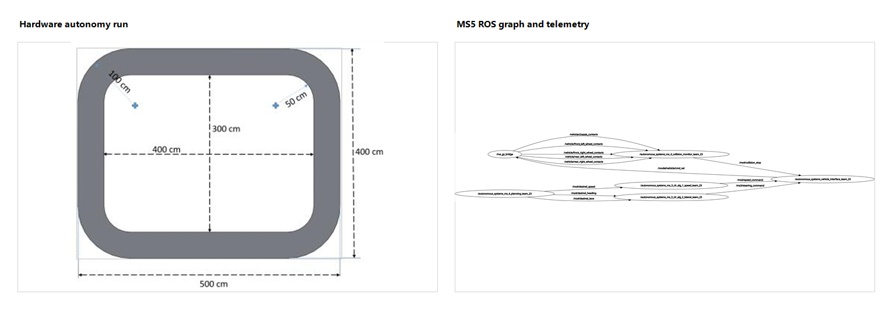
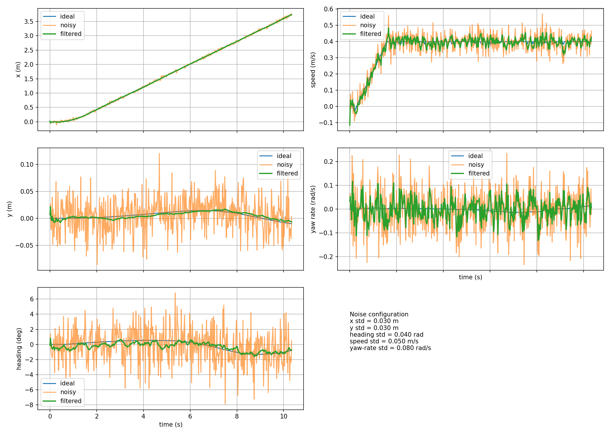
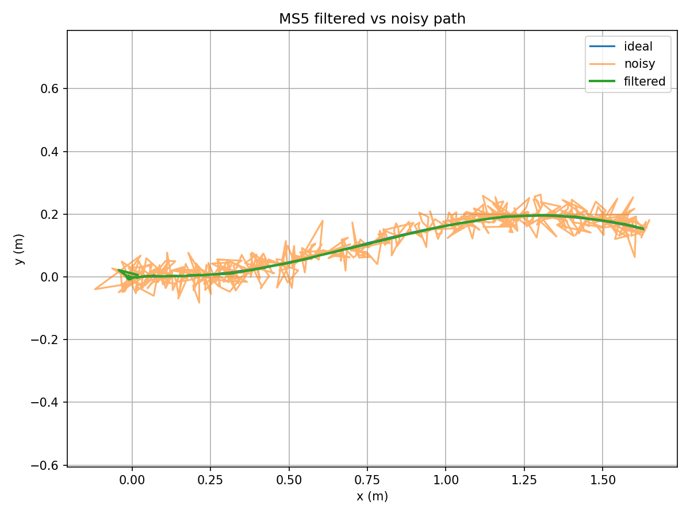

# Autonomous Ackermann Vehicle

[](https://github.com/andrew-abdelmalak/autonomous-ackermann-vehicle/actions/workflows/ci.yml)
[](LICENSE)
[](https://docs.ros.org/en/jazzy/)
[](https://gazebosim.org/docs/harmonic)
[](https://www.python.org/)
[](docs/autonomous_ackermann_vehicle_paper.pdf)

Integrated ROS 2 Jazzy and Gazebo Harmonic autonomy stack for a 1/10-scale Ackermann vehicle, combining quintic obstacle-avoidance and city path planning, feedforward PID speed control, Stanley lateral steering, 5-state Kalman localization, and embedded ATmega328P and RP2040 microcontroller firmware.

**Course:** MCTR 1002 Autonomous Systems, German University in Cairo (Spring 2026, Team 23)  
**Paper:** [Compiled IEEE Paper (PDF)](docs/autonomous_ackermann_vehicle_paper.pdf) | [LaTeX Source](paper/main.tex)

<p align="center">
  
</p>
<p align="center"><em>Physical headless autonomy demonstration alongside the Milestone 5 ROS 2 pipeline graph.</em></p>

## System Architecture

Simulation and hardware share the same `/odom` localization topic, planner targets, and velocity-command pipeline. During simulation, Gazebo publishes ideal odometry that `ms5_localization_team_23` corrupts with configurable Gaussian noise and filters before feeding the planner and controllers. On hardware, the Raspberry Pi 4 communicates over USB serial with an ATmega328P or Raspberry Pi Pico RP2040 motor and steering controller.

```mermaid
flowchart LR
  Sim["Gazebo Harmonic<br/>Empty / Racing / City SDF"] -->|"ideal odom (ros_gz_bridge)"| Loc["MS5 Localization<br/>5-State Kalman Filter"]
  Loc -->|"/odom (filtered)"| Plan["MS4 Planner<br/>SDF Worlds + Quintic / City Path"]
  Plan -->|"/ms4/desired_speed<br/>desired_lane, desired_heading"| Speed["MS3 Speed Control<br/>Feedforward + PID + Slew"]
  Plan --> Lat["MS3 Lateral Control<br/>Stanley + Heading PD + Slew"]
  Speed -->|"/ms3/speed_command"| Lat
  Lat -->|"/model/vehicle/cmd_vel"| Out{"Actuation Target"}
  Out -->|"Simulation"| Sim
  Out -->|"Hardware USB Serial"| MCU["ATmega328P / RP2040 Pico<br/>L298N + MG995 + Encoder + IMU"]
```



## Validation Scope: Hardware vs. Reproducible Checks

This repository cannot benchmark physical hardware without the physical chassis, motor driver, encoder, IMU, and bench setup. We state below what was demonstrated on hardware during the course and what anyone can reproduce headless today.

| Validation layer | How it was verified | Current status / reproducibility |
|---|---|---|
| Physical vehicle run | Onboard Raspberry Pi 4 + microcontroller headless tracks (`paper/figures/final_autonomy_panel.png`) | Qualitative hardware demonstration in course artifacts; no synchronized hardware ground-truth CSV exists |
| Gazebo simulation & localization (MS5) | Recorded simulation runs injecting Gaussian noise into `/ms5/ideal_odom` | Exported RMSE reductions documented in `paper/main.tex`; launchable with `Autonomous_Systems_MS_5_Team_23.launch.py` |
| Planner, controller & Kalman math | Deterministic `pytest` suite (`test_autonomy_math.py`) inside ROS 2 Jazzy Docker | Reproducible on every push and PR via CI (`10 tests`: 3 ament linters and 7 checks of SDF parsing, clearance, PID, Stanley, angle, and Kalman behavior) |
| Microcontroller sketches | `arduino-cli` builds for Arduino Uno (`arduino:avr:uno`) and Pico (`arduino:mbed_rp2040:pico`) | Reproducible in CI and locally with `arduino-cli` |
| Python linting & formatting | `ruff check .` and `ruff format --check .` plus `ament_{copyright,flake8,pep257}` | Reproducible locally and in CI (`pyproject.toml`, line length 99, single quotes) |

## Quantitative Summary (Exported MS5 Artifacts)

The straight-track metrics and the racing-track position, heading, and gain percentages below come from [`paper/main.tex`](paper/main.tex); the racing-track duration (`10.64 s`) and speed RMSE (`0.0502 -> 0.0265 m/s`) come from the exported MS5 CSV artifacts (not archived in this repository; TODO: archive raw MS5 CSV exports if recovered) and match the `47.2%` speed gain reported in `paper/main.tex`. All runs are checked for the same effect (position and heading gain above 80 percent on a straight run) by [`test_autonomy_math.py`](src/Autonomous_Systems_Project_Team_23/test/test_autonomy_math.py).

| Scenario | Duration | Position RMSE (Noisy -> Filtered) | Heading RMSE (Noisy -> Filtered) | Speed RMSE (Noisy -> Filtered) | Reduction (Pos / Heading / Speed) |
|---|---:|---:|---:|---:|---|
| Straight track | 10.34 s | 4.17 cm -> 0.71 cm | 2.19 deg -> 0.42 deg | 0.0495 -> 0.0243 m/s | 82.9% / 81.0% / 51.0% |
| Racing track | 10.64 s | 4.17 cm -> 0.69 cm | 2.19 deg -> 0.42 deg | 0.0502 -> 0.0265 m/s | 83.5% / 80.7% / 47.2% |

<p align="center">
  
</p>
<p align="center"><em>Straight-track MS5 trajectory: Kalman-filtered state histories compared against ideal and noisy signals.</em></p>

<p align="center">
  
</p>
<p align="center"><em>Racing-track MS5 XY path: the filtered trajectory tracks the quintic lane-change corridor past both fixed obstacles.</em></p>

## Quick Start

### 1. Run Unit Tests and Linters via Docker (No Local ROS Install Needed)

```bash
git clone https://github.com/andrew-abdelmalak/autonomous-ackermann-vehicle.git
cd autonomous-ackermann-vehicle

# Python style checks (Ruff)
ruff check .
ruff format --check .

# Build the ROS 2 package and run all 10 unit + ament tests inside ROS 2 Jazzy
docker run --rm -v "$PWD:/ws" -w /ws \
  ros@sha256:00b8d47a6e6384a2834e3d01fa87ae767876543baa574f2d64a75c04ea33c698 \
  bash -lc "source /opt/ros/jazzy/setup.bash && \
    colcon --log-base /tmp/log build --build-base /tmp/build --install-base /tmp/install --packages-select Autonomous_Systems_Project_Team_23 && \
    colcon --log-base /tmp/log test --build-base /tmp/build --install-base /tmp/install --packages-select Autonomous_Systems_Project_Team_23 && \
    colcon --log-base /tmp/log test-result --test-result-base /tmp/build --verbose"
```

### 2. Compile Embedded Firmware

Install `arduino-cli` and the two pinned board cores (`arduino:avr@1.8.8`, `arduino:mbed_rp2040@4.6.0`, plus `Servo@1.3.0`), then build both targets:

```bash
arduino-cli core update-index
arduino-cli core install arduino:avr@1.8.8 arduino:mbed_rp2040@4.6.0
arduino-cli lib install "Servo@1.3.0"

arduino-cli compile --fqbn arduino:avr:uno arduino/vehicle_controller
arduino-cli compile --fqbn arduino:mbed_rp2040:pico arduino/pico_ms4_all_tracks
```

### 3. Run Full Gazebo Harmonic Simulation (Native Ubuntu 24.04 + ROS 2 Jazzy)

Requires Ubuntu Noble (24.04), ROS 2 Jazzy, Gazebo Harmonic (`ros-jazzy-ros-gz`, `ros-jazzy-ros-gz-sim`, `ros-jazzy-ros-gz-bridge`), and `matplotlib` if `save_artifacts:=true`:

```bash
source /opt/ros/jazzy/setup.bash
colcon build --packages-select Autonomous_Systems_Project_Team_23
source install/setup.bash

# Default MS5 racing track with GUI
ros2 launch Autonomous_Systems_Project_Team_23 Autonomous_Systems_MS_5_Team_23.launch.py

# Headless City Track simulation without artifact plots
ros2 launch Autonomous_Systems_Project_Team_23 Autonomous_Systems_MS_5_Team_23.launch.py \
  world_file:=City_Track.world \
  planner_track_mode:=city_track \
  headless:=true \
  save_artifacts:=false
```

Available world SDF files in `src/Autonomous_Systems_Project_Team_23/Worlds/`:

- `Empty_Track.world`: 10 m straight corridor (`y = +/-0.35 m`, no obstacles).
- `Racing_Track.world`: 10 m corridor (`y = +/-0.375 m`) with two staggered lane obstacles (`(4.0, 0.1875)` on the left lane and `(8.0, -0.1875)` on the right lane).
- `City_Track.world`: closed oval loop (`+/-3.0 m` straight walls, `+/-2.0 m` curved walls).

## Configuration and Firmware Details

### Default MS5 Launch Parameters

Values below come from [`Autonomous_Systems_MS_5_Team_23.launch.py`](src/Autonomous_Systems_Project_Team_23/launch/Autonomous_Systems_MS_5_Team_23.launch.py):

| Component | Parameter | Default value |
|---|---|---|
| Vehicle & loop | `wheel_base` / `publish_rate_hz` | `0.255 m` / `20.0 Hz` |
| Speed limits | `max_speed` / `max_acceleration` | `0.40 m/s` / `0.30 m/s^2` |
| Speed PID | `speed_kp`, `speed_ki`, `speed_kd`, `speed_integral_limit` | `0.85`, `0.10`, `0.03`, `1.5` |
| Stanley & heading | `lateral_kp`, `lateral_kd`, `heading_kp`, `heading_kd` | `0.30`, `0.10`, `0.50`, `0.15` |
| Steering limits | `max_steering_angle` / `max_steering_rate` / `max_turn_rate` | `0.30 rad` / `0.22 rad/s` / `0.65 rad/s` |
| Racing profile | `racing_straight_speed` / `racing_lane_change_speed` | `0.26 m/s` / `0.14 m/s` |
| City profile | `city_straight_speed` / `city_turn_speed` | `0.35 m/s` / `0.18 m/s` |
| Kalman `R` std devs | `(x, y, theta, v, omega)` | `0.03 m, 0.03 m, 0.04 rad, 0.05 m/s, 0.08 rad/s` |
| Kalman `Q` std devs | `(v, omega)` (pose fixed at `1e-8`) | `0.025 m/s`, `0.05 rad/s` |

### Microcontroller Sketches

- [`arduino/vehicle_controller/vehicle_controller.ino`](arduino/vehicle_controller/vehicle_controller.ino): Arduino Uno (ATmega328P) serial motor + servo controller used in Milestones 2 and 3 (`748.0` ticks per wheel revolution on `0.065 m` wheels, `SPEED_KP = 150.0` + feedforward PWM, `SERVO_CENTER = 90` +/- `40` deg, `2000 ms` watchdog timeout).
- [`arduino/pico_ms4_all_tracks/pico_ms4_all_tracks.ino`](arduino/pico_ms4_all_tracks/pico_ms4_all_tracks.ino): Raspberry Pi Pico RP2040 controller for Milestones 4 and 5 (`50 Hz` loop, `7000.0` encoder ticks/m, `300`-sample MPU-6050 gyro bias calibration at startup, onboard PD heading stabilization with `STEERING_KP = 1.5` and `STEERING_KD = 0.8`, streaming `VEL:<float>,THETA:<float>,TICKS:<int>` at `20 Hz`).

## Repository Layout

```text
.
├── .github/
│   ├── workflows/ci.yml                 # Ruff, ROS 2 Jazzy colcon test, and Arduino CLI builds
│   └── dependabot.yml                   # Monthly grouped updates with 14-day cooldown
├── arduino/
│   ├── vehicle_controller/              # Arduino Uno ATmega328P sketch (MS2-MS3)
│   └── pico_ms4_all_tracks/             # Raspberry Pi Pico RP2040 sketch (MS4-MS5)
├── assets/
│   ├── social-preview.svg               # 1280x640 repository social preview source
│   └── social-preview.png               # Rendered 1280x640 social preview image
├── docs/
│   ├── autonomous_ackermann_vehicle_paper.pdf
│   ├── MS1_Literature_Review.pdf
│   └── MS5_Final_Report.pdf
├── paper/
│   ├── main.tex                         # IEEEtran paper source synced with code
│   ├── references.bib
│   └── figures/
├── src/Autonomous_Systems_Project_Team_23/
│   ├── Autonomous_Systems_Project_Team_23/   # MS1-MS5 ROS 2 nodes
│   ├── launch/                          # Gazebo Harmonic and teleop launch files
│   ├── models/                          # team23_ackermann_ms4 and prius_team23 SDF models
│   ├── Worlds/                          # Empty_Track, Racing_Track, and City_Track SDFs
│   ├── test/                            # ament linters and test_autonomy_math.py
│   ├── package.xml
│   └── setup.py
├── pyproject.toml                       # Ruff lint and formatting configuration
├── requirements.txt                     # Pinned Python dependencies (numpy, matplotlib)
├── CITATION.cff
├── CONTRIBUTING.md
├── CHANGELOG.md
├── CODE_OF_CONDUCT.md
├── SECURITY.md
└── LICENSE
```

## Known Limitations

1. **Known static tracks only:** The MS4 planner parses static box/wall geometry from the world SDF files and assumes fixed obstacle placement; there is no camera or LiDAR perception pipeline for dynamic obstacles or unknown maps.
2. **Proprioceptive hardware sensing:** Physical runs rely on quadrature encoder ticks and MPU-6050 yaw-rate integration without external motion-capture or RTK-GPS ground truth.
3. **Simulation-scoped localization benchmark:** Reported RMSE numbers evaluate the 5-state linear Kalman filter against injected Gaussian noise on Gazebo `/ms5/ideal_odom`, not against physical hardware ground truth.

## Team and Acknowledgments

**Team 23** (German University in Cairo, MCTR 1002 Autonomous Systems):

- [Andrew Abdelmalak](https://github.com/andrew-abdelmalak)
- [Daniel Boules](https://github.com/daniel-boules)
- [David Girgis](https://github.com/davidlouiss)
- [Kirolous Kirolous](https://github.com/Kiro579)
- [Samir Yacoub](https://github.com/SamirYacoub)
- Youssef Salama

**Supervision:** Dr. Omar M. Shehata and Eng. Dalia M. Mahfouz.

## License

Released under the [MIT License](LICENSE). See [CHANGELOG.md](CHANGELOG.md) for release history and [CONTRIBUTING.md](CONTRIBUTING.md) for development checks.
